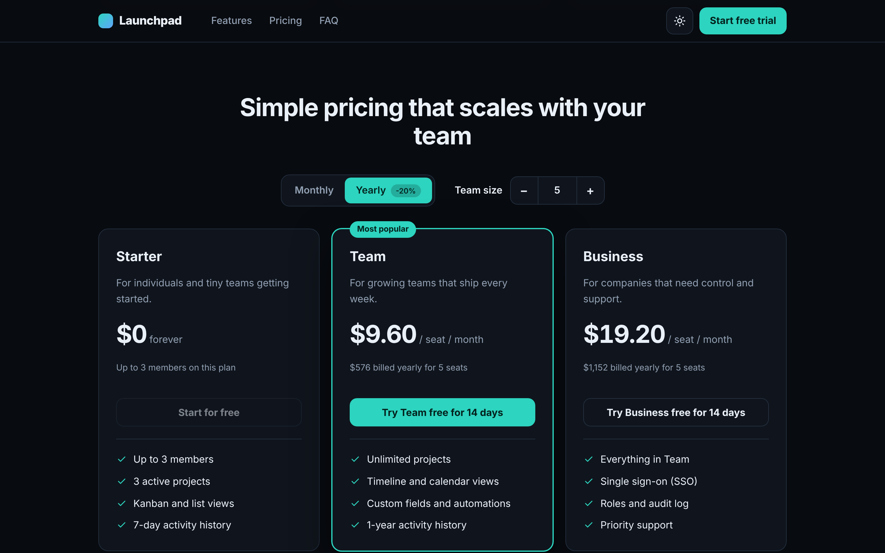

# Launchpad

A responsive SaaS pricing page with a billing toggle, seat-based pricing and a three-step signup flow in an accessible modal. Built with React 19 and TypeScript, with no UI libraries. A concept project: the product, plans and prices are fictional.

## Features

- **Pricing with live calculation:** monthly / yearly toggle (-20%), team size stepper (1-50), per-seat price and totals update instantly
- **Plan limits:** the Starter plan is disabled above 3 members, with a clear message instead of a silent failure
- **Multi-step signup in a modal:** account, workspace, plan. Per-step validation, a password strength hint, show/hide password, order summary
- **Forms done properly:** `aria-invalid` + `aria-describedby`, focus moves to the first error and to each new step heading, server errors land on the right field (try `taken@example.com`)
- **Dialog accessibility:** `role="dialog"`, focus trap, `Escape` to close, scroll lock, focus restored to the trigger
- **FAQ accordion** with `aria-expanded` / `aria-controls`
- **Adaptive layout:** plans stack on tablets and phones, burger menu and bottom-sheet modal on small screens, 44px tap targets, 16px inputs (no iOS zoom)
- **Light and dark themes** that follow the system setting, persist, and never flash on load
- `prefers-reduced-motion` respected

## Backend-ready

Pricing rules live in `src/lib/pricing.ts` and validation in `src/lib/validation.ts` as pure, unit-tested functions. Signup goes through one function, `createWorkspace()` in `src/lib/api.ts`, a mock with latency and a field-level error case. Swapping its body for a `fetch()` call connects a real backend; the UI already handles pending, field and generic errors.

## Stack

React 19, TypeScript (strict), Vite, Vitest + Testing Library, ESLint, Prettier. Plain CSS with design tokens.

## Scripts

| Command             | Description                        |
| ------------------- | ---------------------------------- |
| `npm run dev`       | Start the dev server               |
| `npm run build`     | Typecheck and build for production |
| `npm test`          | Unit and component tests           |
| `npm run lint`      | ESLint                             |
| `npm run typecheck` | TypeScript check                   |

## Deployment

Import the repository in Vercel, set Root Directory to `launchpad` (preset: Vite).

## License

MIT
