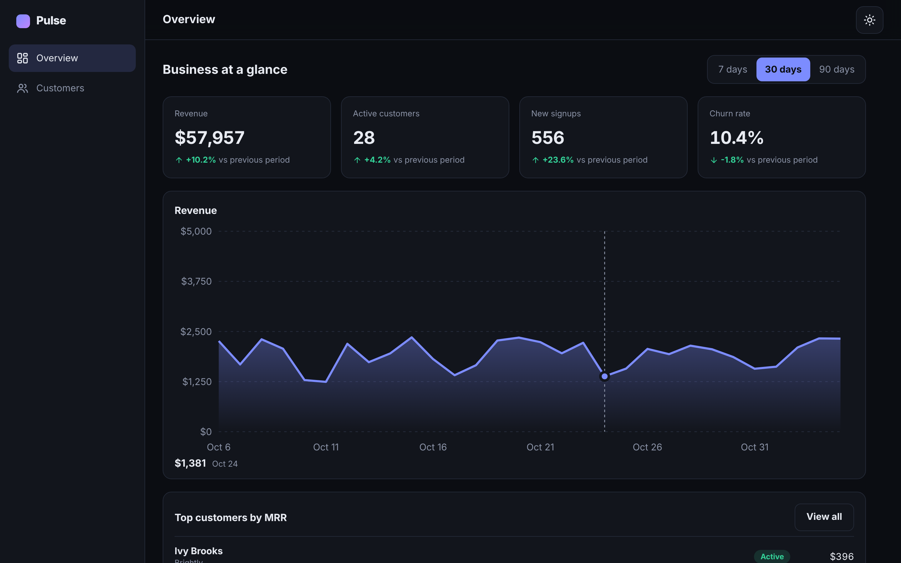

# Pulse

A responsive SaaS analytics dashboard: KPI cards, an interactive revenue chart and a customer table with search, sorting, filtering, pagination and a details panel. Built with React 19 and TypeScript, with no UI or chart libraries.

## Features

- **Overview:** four KPI cards with period-over-period deltas and a 7 / 30 / 90 day range switch
- **Revenue chart:** hand-written responsive SVG with a hover readout and a text alternative for screen readers
- **Customers table:** search by name, email or company, status filter, sortable columns (`aria-sort`), pagination
- **Details panel:** a side drawer on desktop and a bottom sheet on phones, with focus trap, `Escape` to close and focus restore
- **Optimistic updates:** marking a customer as churned updates the UI at once and rolls back with a toast if the request fails
- **Loading, empty and error states** for every screen (open the app with `?error=1` to see the error state and retry)
- **Light and dark themes** that follow the system setting, persist, and never flash on load
- **Adaptive layout:** sidebar on desktop, bottom tab bar on phones, table rows turn into cards under 760px

## Backend-ready

All data goes through `src/data/api.ts`, a mock API with artificial latency (`VITE_API_LATENCY_MS`). Every function returns a Promise, so components already handle loading, errors and retries. Replacing the bodies with `fetch()` calls connects a real backend without touching the UI.

Filtering, sorting, pagination and KPI aggregation are pure functions in `src/lib` and are unit tested without React.

## Stack

React 19, TypeScript (strict), Vite, Vitest + Testing Library, ESLint, Prettier. Plain CSS with design tokens (CSS variables) for theming.

## Scripts

| Command             | Description                        |
| ------------------- | ---------------------------------- |
| `npm run dev`       | Start the dev server               |
| `npm run build`     | Typecheck and build for production |
| `npm test`          | Unit and component tests           |
| `npm run lint`      | ESLint                             |
| `npm run typecheck` | TypeScript check                   |

## Deployment

Import the repository in Vercel, set Root Directory to `pulse` (preset: Vite).

## License

MIT
